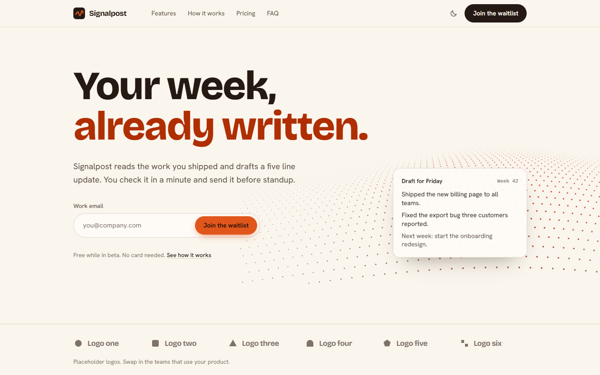
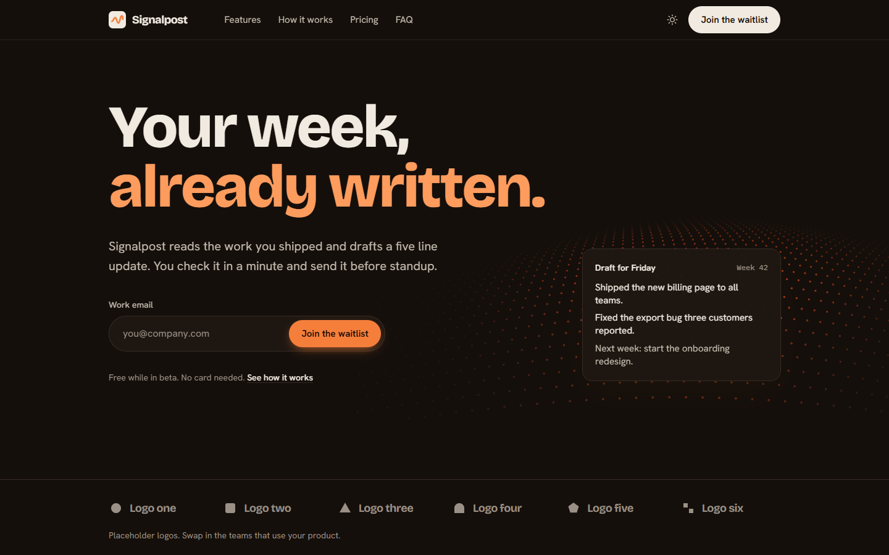
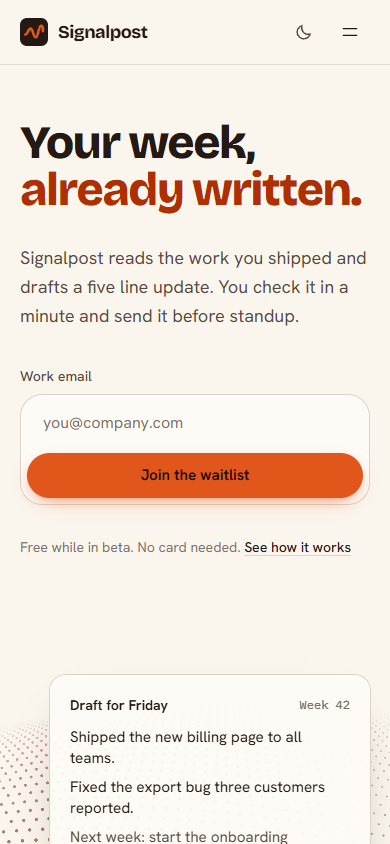

# Leo's starter: SaaS landing page

A landing page you can sell from, with a waitlist that actually stores signups.
Built with Next.js (App Router), TypeScript, Tailwind CSS, GSAP and three.js.

Leo's starters are free templates from [Replore](https://replore.cardzo.co.in), a Cardzo product
that helps you find open source GitHub repos for what you are building.



| Dark theme | Phone |
| --- | --- |
|  |  |

## What you get

- Sections: navigation, hero with a working signup form, logo strip (placeholder marks),
  features, how it works, pricing with three tiers and a monthly and yearly toggle,
  testimonials (clearly marked placeholders), FAQ, final call to action and footer.
- A working waitlist: the form posts to `/api/waitlist`, which validates the email, rejects
  bots with a hidden honeypot field, limits each visitor to 5 attempts per 10 minutes, saves
  the signup and shows a success or error message.
- One file for all copy: `src/config/site.ts` holds the name, tagline, features, steps,
  prices, quotes, FAQ and footer links.
- Light and dark theme. It follows the visitor's system setting, remembers a manual choice,
  and never flashes the wrong theme on load.
- A 3D "signal field" in the hero (three.js) that ripples under the pointer and swells as you
  scroll. It loads after the page is idle, caps the pixel ratio, stops rendering when off
  screen or in a background tab, and shows a still drawing instead when WebGL is missing or
  the visitor prefers reduced motion.
- GSAP motion: a hero intro, a features list that arrives as a list, a progress track through
  the how it works steps that follows your scroll, pricing tiers that unmask, and prices that
  count to their new value when you switch billing. All of it is skipped under reduced motion,
  and content is visible even if JavaScript fails.
- Search basics: title and description metadata, a generated Open Graph image
  (`/opengraph-image`), `sitemap.xml`, `robots.txt`, JSON-LD for the product, a skip link and
  real heading order.

## Quick start

You need Node.js 20.9 or newer.

```bash
npm install
npm run dev
```

Open http://localhost:3000 and try the form. Signups are written to `data/waitlist.json`
(this folder is ignored by git, because signups are personal data).

Other commands:

```bash
npm run build   # production build
npm run start   # serve the production build on port 3000
npm run lint    # ESLint
npm run typecheck
```

## Make it yours

1. Edit `src/config/site.ts`. Every word on the page comes from there.
2. Change colours in `src/app/globals.css`. The `:root` block is the light theme and the
   `.dark` block is the dark theme. Components only use role names such as `paper`, `ink` and
   `signal`, so changing a value there updates the whole page.
3. Change fonts in `src/app/layout.tsx` (any font from `next/font/google`).
4. Replace the placeholder logos in `src/components/logo-strip.tsx` and the quotes in the
   config with real ones you have permission to use.
5. Change the hero field colours in `PALETTE` at the top of
   `src/components/hero/wave-field.tsx`.
6. Set `NEXT_PUBLIC_SITE_URL` to your real address so the sitemap and social cards are correct.

## Environment variables

Copy `.env.example` to `.env.local`. None are required for local use.

| Variable | What it does |
| --- | --- |
| `NEXT_PUBLIC_SITE_URL` | Your production address, used for canonical links, the sitemap, robots.txt and the Open Graph image. Defaults to `http://localhost:3000`. |
| `WAITLIST_WEBHOOK_URL` | If set, each new signup is also sent as a JSON POST to this URL (Zapier, Make, n8n, a Slack workflow or your own API). |
| `WAITLIST_FILE` | Path of the JSON file. Defaults to `data/waitlist.json`. |
| `WAITLIST_DISABLE_FILE` | Set to `1` on hosts with a read only disk so only the webhook is used. |

The webhook receives:

```json
{ "type": "waitlist.signup", "email": "you@company.com", "source": "hero", "createdAt": "2026-10-23T09:00:00.000Z" }
```

The route only reports success when at least one store accepted the signup. If the file
cannot be written and no webhook is set, the visitor sees an error rather than a false
"you are on the list".

## Swap the waitlist store

The JSON file is fine for local use and for a single server with a disk. On Vercel, Cloudflare
and other serverless hosts the disk is read only, so use one of these:

- **No code:** set `WAITLIST_WEBHOOK_URL` and `WAITLIST_DISABLE_FILE=1`. Point the webhook at a
  Zapier or Make zap that adds a row to Google Sheets, Airtable or your email tool.
- **A database:** open `src/lib/waitlist.ts` and replace the body of `saveToFile` with an insert
  into your store. Return `"duplicate"` if the email already exists and `"created"` otherwise.
  For example with Supabase, Neon (Postgres), Turso or Upstash Redis, insert into a table with
  a unique index on `email`. Nothing else in the app needs to change.
- **Stronger rate limits:** the limiter in `src/lib/rate-limit.ts` keeps counts in memory, which
  resets per server instance. For a shared limit, use Upstash Ratelimit or your host's firewall.

## Deploy

### Vercel

1. Push this folder to a GitHub repository.
2. In Vercel, choose Add New, then Project, and import the repository. The defaults
   (framework Next.js, build `next build`) are correct.
3. Under Environment Variables add `NEXT_PUBLIC_SITE_URL`, `WAITLIST_WEBHOOK_URL` and
   `WAITLIST_DISABLE_FILE=1` (the disk is read only on Vercel).
4. Deploy.

### Cloudflare (Workers or Pages)

Cloudflare runs Next.js through the OpenNext adapter.

1. Install the adapter and Wrangler:
   ```bash
   npm install --save-dev @opennextjs/cloudflare wrangler
   ```
2. Follow the adapter's setup guide at https://opennext.js.org/cloudflare to add
   `wrangler.jsonc` and `open-next.config.ts`, and turn on the `nodejs_compat` flag.
3. Add `NEXT_PUBLIC_SITE_URL`, `WAITLIST_WEBHOOK_URL` and `WAITLIST_DISABLE_FILE=1` as
   variables in the Cloudflare dashboard (there is no writable disk).
4. Build and deploy with `npx opennextjs-cloudflare build` and `npx opennextjs-cloudflare deploy`,
   or connect the repository in the Cloudflare dashboard with the same build command.

These Cloudflare steps follow the adapter's documentation and have not been tested with this
exact template. Vercel and `npm run start` on a normal server are the tested paths.

## Project layout

```
src/
  app/
    api/waitlist/route.ts   waitlist endpoint
    layout.tsx              fonts, metadata, theme script
    page.tsx                section order
    opengraph-image.tsx     social card, generated from the config
    sitemap.ts, robots.ts
    globals.css             colour roles, type, browser surfaces
  components/               one file per section, plus hero/ (3D field and fallback)
  config/site.ts            all copy
  lib/                      waitlist store, rate limit, validation
```

## Licence and credits

MIT, Copyright (c) 2026 Cardzo. See `LICENSE`.

GSAP is free for commercial use but uses its own licence, not MIT. Read `NOTICE.md` before you
sell a site or template built on this, and see there how to remove GSAP if you need a pure MIT
stack. three.js, Next.js, React and Tailwind CSS are MIT. Structure was informed by
nextjs/saas-starter, ixartz/SaaS-Boilerplate and Blazity/next-saas-starter (all MIT, no code
copied). Design rules follow pbakaus/impeccable (Apache-2.0).
